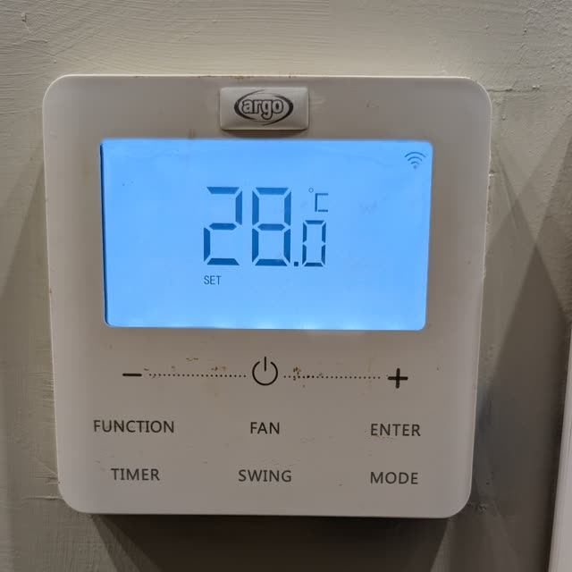

# Gree Local Cloud

Control compatible Gree air conditioners locally over MQTT, with optional Home Assistant discovery. This works on stock gree firmware and requires an account just to connect the AC to the local network.

## Tested hardware

| Wi-Fi module | Firmware | Result |
| --- | --- | --- |
| U-WB04BRT13 | 1.38 | Local MQTT control verified |
| U-WB04BRT13 | 1.40 | Local MQTT control verified |

If another unit works for you, [open an issue](https://github.com/chicco-carone/gree-local-cloud/issues/new) with its AC model, Wi-Fi module, firmware version, and the controls you tested so it can be added to this table.

Other modules and firmware are unverified. If your AC supports the standard Gree LAN integration, use that first.



*The tested installation’s controller; compatibility depends on the Wi-Fi module and firmware, not its appearance.*

**How it works:** Router redirects send the AC to a Python TLS/MQTT emulator, which uses predictable TLS randomness in the tested firmware to replace the cloud and bridge controls to your MQTT broker.

## Setup

You need Docker Compose, an MQTT broker, stable AC/server IPs, and a router supporting device-specific destination NAT and firewall rules.

```sh
git clone https://github.com/chicco-carone/gree-local-cloud.git
cd gree-local-cloud
cp .env.example .env
mkdir -p data
```

First, [find your AC’s IP, module ID, unit ID, and firmware](docs/device-info.md) using the router and the read-only lookup helper (or existing HA integration logs).

Edit `.env` with your Docker host IP (`GREE_SERVER_IP`), AC IP (`GREE_DEVICE_IP`), module/unit IDs (`GREE_MODULE_MAC` / `GREE_UNIT_MAC`, without colons), and MQTT broker credentials. Verify the unit ID rather than assuming the module ID plus `00`.

Optional: set `HA_DISCOVERY=false` for standalone MQTT without Home Assistant, `LANGUAGE=it` or `LANGUAGE=en` for Italian or English swing menus, or `TEMPERATURE_TOPIC` for an external sensor’s numeric Celsius reading.

```sh
docker compose pull
docker compose up -d
```

Image: `ghcr.io/chicco-carone/gree-local-cloud:latest`. Private packages require an authenticated GHCR login.

Then configure your router:

| AC traffic | Redirect to Docker host |
| --- | --- |
| UDP 53 | UDP 1053 |
| TCP 1813 | TCP 1813 |
| TCP 1982 and 1992 | TCP 1982 |

Match only the AC’s source IP and preserve it. Allow these local connections and block the AC’s Internet access over IPv4 and IPv6.

Follow the [illustrated UniFi guide](docs/router-unifi.md), tested on **Cloud Gateway Ultra**; other supported UniFi gateways may place settings elsewhere. An [iptables alternative](docs/router-iptables.md) is also available.

After routing, check `docker compose logs -f` and MQTT availability at `gree_local/<unit_id>/availability`. Keep `.env` and `data/` private.

## More details

- [Finding AC identifiers and firmware](docs/device-info.md)
- [Configuration, MQTT commands, multiple ACs, and troubleshooting](docs/reference.md)
- [Protocol findings and compatibility limits](docs/protocol.md)

## Contributing

Issues and pull requests are welcome. Include your module model, firmware version, and redacted logs when reporting compatibility problems. Before submitting, run `uv sync --frozen`, `uv run pytest -q`, `uv run ruff check .`, `uv run ruff format --check .`, and `uv run ty check`.

**AI use:** OpenAI Codex with GPT-6.1-sol assisted with protocol investigation, implementation, tests, and documentation; compatibility was checked on the devices listed above and all code was later reviewed and tested.
