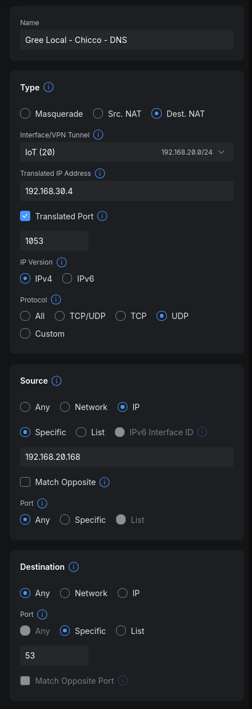
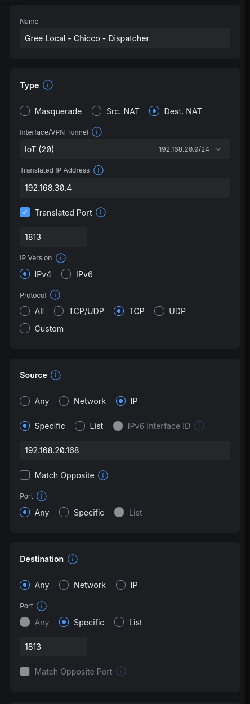
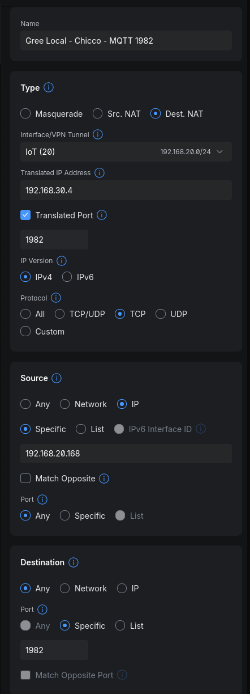
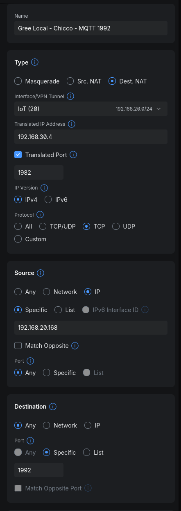
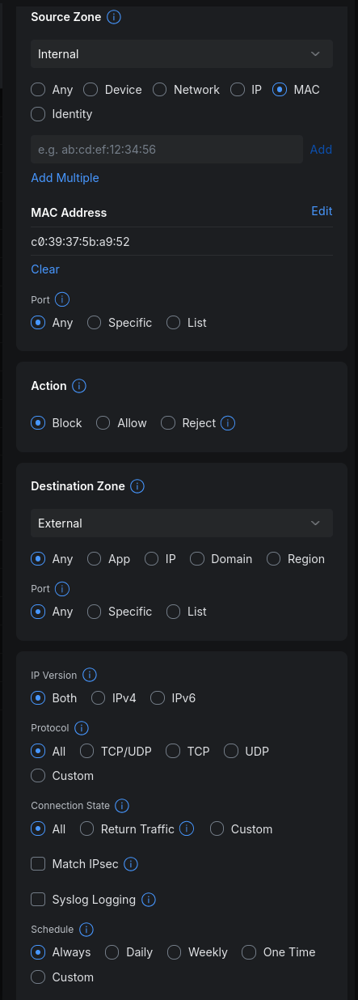

# UniFi router configuration

Configure native UniFi Network policies to redirect a compatible AC to the local bridge. This setup was tested on a **Cloud Gateway Ultra running UniFi Network 10.6.109**. It should also work on other UniFi gateways that support the required destination NAT and firewall policies, though menu locations and setting names may differ by model and UniFi Network version. The screenshots show the tested setup. Repeat the rules for each AC, using its own source address and published container ports.

## Before you begin

Reserve the AC and Docker host addresses under **Client Devices → select device → Settings → Fixed IP Address**. Identify the network/VLAN containing the AC and start the bridge container before enabling the redirects.

The screenshots use the following example values. Replace them with your own:

| Screenshot value | Meaning |
| --- | --- |
| `192.168.20.168` | AC’s reserved IPv4 address |
| `192.168.30.4` | Docker host’s reserved LAN IPv4 address |
| `IoT (20)` | Incoming network containing the AC |

The AC’s traffic must traverse the gateway, and its source IP must be preserved because the bridge checks it. The Docker host and AC can be on different VLANs.

## Create destination NAT policies

Open **Settings → Policy Engine → Policy Table**, filter by **NAT**, and choose **Create New Policy → NAT → Dest. NAT**. Some releases show **Settings → Policy Table** directly; older releases expose **Settings → Policy Engine → NAT**. See [Ubiquiti’s NAT instructions](https://help.ui.com/hc/en-us/articles/16437942532759-DNAT-SNAT-and-Masquerading-in-UniFi) for version-specific navigation.

Use these common settings for all four rules:

- **Interface/VPN Tunnel:** the network containing the AC.
- **Translated IP Address:** Docker host LAN address.
- **Translated Port:** enabled, with the service’s published host port.
- **IP Version:** IPv4.
- **Source:** IP → Specific → AC address; source port Any.
- **Destination:** Any; destination port Specific.
- Leave the opposite-match options disabled.

Use destination NAT for LAN-originated traffic. Do not select a WAN interface or add source masquerading. These settings do not require a static route to a Gree cloud IP.

### 1. DNS

| Field | Value |
| --- | --- |
| Protocol | UDP |
| Destination port | `53` |
| Translated port | `1053` |

Place this rule **before any network-wide DNS interception rule**. Keep the broader rule for other clients. The bridge answers the observed Gree DNS names without an upstream resolver; other regions may need different `GREE_DNS_NAMES`.

### 2. Dispatcher

| Field | Value |
| --- | --- |
| Protocol | TCP |
| Destination port | `1813` |
| Translated port | `1813` |

This redirects the device’s startup dispatcher connection to the local bridge.

### 3. MQTT on port 1982

| Field | Value |
| --- | --- |
| Protocol | TCP |
| Destination port | `1982` |
| Translated port | `1982` |

### 4. MQTT on port 1992

| Field | Value |
| --- | --- |
| Protocol | TCP |
| Destination port | `1992` |
| Translated port | `1982` |

The original destination port is **1992**, but the translated port is **1982**: both cloud MQTT ports lead to the same local endpoint. Use separate rules; the tested native NAT API accepts single ports or contiguous ranges, not a comma-separated port list.

## Allow local connectivity

If the AC and Docker host are isolated by firewall zones, create a local-access policy permitting the AC to reach the Docker host on UDP `1053` and TCP `1813`/`1982`, including return traffic. Use the translated ports when configuring the forwarding policy. An existing zone policy may already permit this; do not add a duplicate if so.

LAN destination NAT does not guarantee a matching firewall allow rule is created. Verify local access separately.

## Block Internet access

In **Policy Table → Firewall**, create a policy with these settings:

| Field | Value |
| --- | --- |
| Source zone | Zone containing the AC |
| Source match | AC’s Wi-Fi MAC address |
| Destination zone | External |
| Destination ports | Any |
| Protocol | All |
| Connection state | All |
| IP version | IPv4 and IPv6 |
| Action | Block |
| Schedule | Always |

A MAC match covers changing IPv6 addresses. Keep local access to the Docker host allowed, and check rule ordering against other matching policies. Avoid the global client **Block** button, which can disconnect the AC from the LAN.

Some releases expose firewall creation through **Settings → Zones → Create Policy**, or **Settings → Policy Engine → Zones**. See [Ubiquiti’s firewall instructions](https://help.ui.com/hc/en-us/articles/115003173168-Zone-Based-Firewalls-in-UniFi).

## Multiple ACs

Repeat the four NAT policies and Internet-block policy for each AC, changing the source IP/MAC and translated host ports. For example, a second container can use DNS `1054`, dispatcher `1814`, and MQTT `1984`. Its original destination ports remain `53`, `1813`, `1982`, and `1992`.

Set the second bridge service’s `GREE_LISTEN_PORT` to `1984` and publish `1984:1984`, because the dispatcher advertises that MQTT port directly. See [multiple-AC configuration](reference.md#multiple-acs).

## Verify and roll back

Confirm that your NAT and firewall policies are enabled in the policy table. Reconnect the AC’s Wi-Fi if it retains an old cloud connection. Confirm that it connects to the local dispatcher and MQTT endpoint, answers a fresh status query, and reports online over MQTT. Check that Internet blocking covers both IP families. Restore the original settings if you test a physical control.

To restore cloud operation, disable only this AC’s native policies and reconnect it. Keep shared DNS and firewall policies used by other devices.
